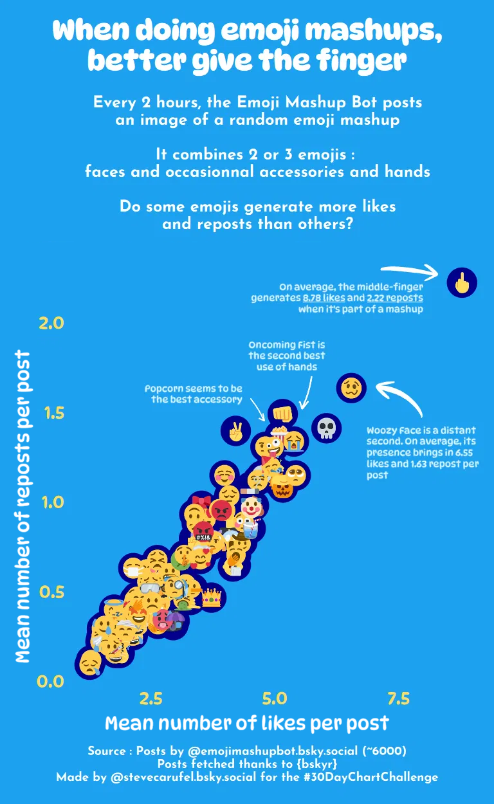

# emoji-mashup-bot-analysis
<a href="https://bsky.app/profile/emojimashupbot.bsky.social">The Emoji Mashup Bot</a> posts every 2 hours. Which emojis give the best and funniest mashups, as per likes and reposts?

The analysis is based on approximately 6,000 posts by the bot, from its creation up to April 2026.

Made with R. Special thanks to the {bskyr} package which made it way easier to fetch posts data. And thanks to the bot's consistent and convenient post pattern.

Post example : 

<blockquote class="bluesky-embed" data-bluesky-uri="at://did:plc:ktb4ykxwtcslx4mmsyzqyozz/app.bsky.feed.post/3n2mrblxxzl2c" data-bluesky-cid="bafyreidbwskxyqy5znyzevnl6wf2bf65z2siuqfbprln42a4cr4sqkkaaq" data-bluesky-embed-color-mode="system">
🥶 cold + 😒 unamused  =  <a href="https://bsky.app/profile/did:plc:ktb4ykxwtcslx4mmsyzqyozz/post/3n2mrblxxzl2c?ref_src=embed">[image or embed]</a>
&mdash; Emoji Mashup Bot (<a href="https://bsky.app/profile/did:plc:ktb4ykxwtcslx4mmsyzqyozz?ref_src=embed">@emojimashupbot.bsky.social</a>) <a href="https://bsky.app/profile/did:plc:ktb4ykxwtcslx4mmsyzqyozz/post/3n2mrblxxzl2c?ref_src=embed">18 novembre 2026 à 19:00</a></blockquote>
